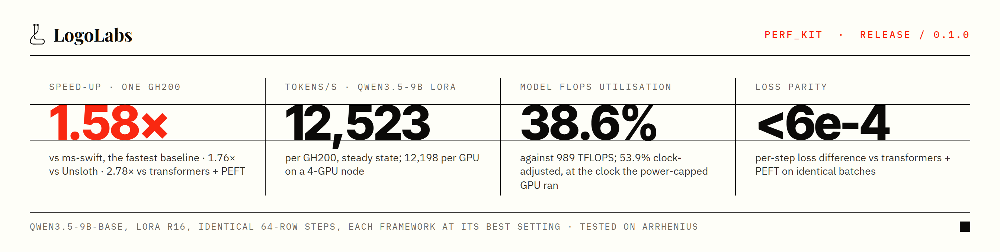
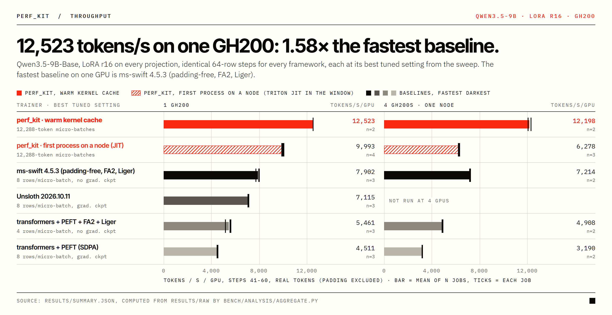
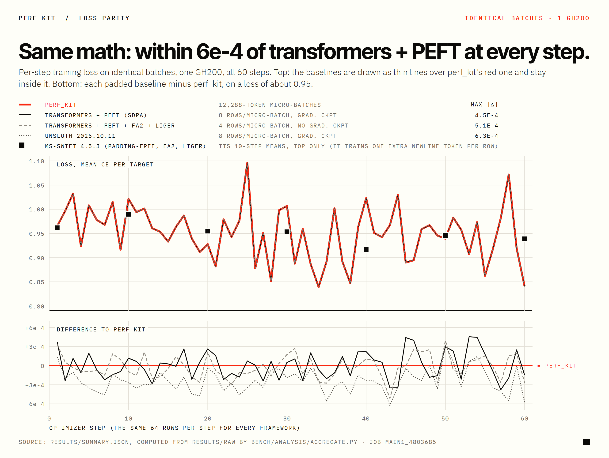
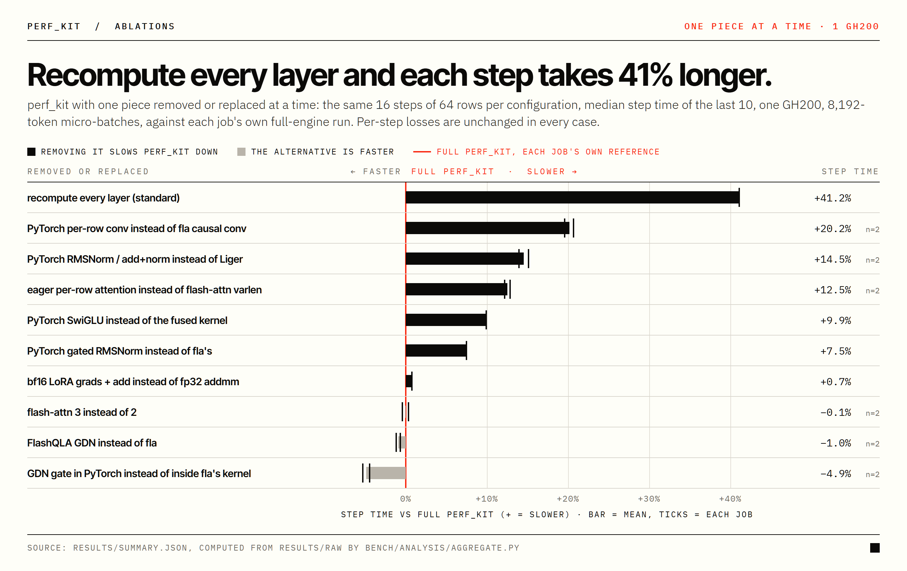

<p align="center"></p>

<p align="center"></p>

<p align="center">
  <a href="LICENSE"></a>
  
  
  
  <a href="report/index.html"></a>
</p>

# perf_kit

*By Stefan-Lucian Deleanu ([LogoLabs.org](https://logolabs.org))*

Fast, exact LoRA fine-tuning for Qwen3.5-style hybrid LLMs (Gated DeltaNet + gated attention) and dense Llama /
Qwen decoders, built and measured on NVIDIA GH200.

perf_kit is a small training engine (~2,600 lines of Python + Triton) that computes the same loss and the same LoRA
gradients as transformers + PEFT (tested in float64 against them) while removing most of the work around the
frozen GEMMs: fused projections with fused LoRA, packed variable-length batches through fla / flash-attention,
fused norms and activations, a recompute plan sized from a start-up measurement, one flat optimizer step, no host
syncs inside a step. It writes standard PEFT adapters.

## Results (public, reproducible)

Qwen3.5-9B-Base, LoRA r16 on every projection, UltraChat first turns (~530 tokens/row), the **same 64 rows per
step in every framework**, each framework at its best setting from a sweep; steady state (steps 41-60 of 60),
GH200 120GB, mean of n separate jobs:

| GPUs | trainer | setting | tokens/s/GPU (min-max) | vs perf_kit | MFU | clock-adj. MFU | SM MHz | peak GB |
|---|---|---|---|---|---|---|---|---|
| 1 | perf_kit (warm kernel cache) | 12288-token packed micro-batches | **12,523** (12,523-12,524, n=2) | 1.00x | 38.6% | 53.9% | 1418 | 81 |
| 1 | perf_kit (cold: first process on node) | 12288-token packed micro-batches | **9,993** (9,918-10,077, n=4) | 1.25x slower | 30.8% | 42.8% | 1425 | 81 |
| 1 | ms-swift 4.5.3 (padding-free, FA2, Liger) | 8 rows/micro-batch, no gradient checkpointing | **7,902** (7,728-8,010, n=3) | 1.58x slower | 24.4% | 31.2% | 1548 | 66 |
| 1 | Unsloth 2026.10.11 | 8 rows/micro-batch, gradient checkpointing | **7,115** (7,070-7,158, n=3) | 1.76x slower | 21.9% | 29.7% | 1465 | 23 |
| 1 | transformers + PEFT + FA2 + Liger | 4 rows/micro-batch, no gradient checkpointing | **5,461** (5,197-5,635, n=3) | 2.29x slower | 16.9% | 19.3% | 1738 | 82 |
| 1 | transformers + PEFT (SDPA) | 8 rows/micro-batch, gradient checkpointing | **4,511** (4,476-4,535, n=3) | 2.78x slower | 13.9% | 17.2% | 1605 | 73 |
| 4 | perf_kit (warm kernel cache) | 12288-token packed micro-batches | **12,198** (12,084-12,313, n=2) | 1.00x | 37.6% | 51.7% | 1440 | 69 |
| 4 | perf_kit (cold: first process on node) | 12288-token packed micro-batches | **6,278** (6,233-6,343, n=3) | 1.94x slower | 19.4% | 26.4% | 1455 | 69 |
| 4 | ms-swift 4.5.3 (padding-free, FA2, Liger) | 8 rows/micro-batch, no gradient checkpointing | **7,214** (7,193-7,235, n=2) | 1.69x slower | 22.2% | 27.8% | 1582 | 64 |
| 4 | transformers + PEFT + FA2 + Liger | 4 rows/micro-batch, no gradient checkpointing | **4,908** (4,882-4,934, n=2) | 2.49x slower | 15.1% | 17.0% | 1762 | 58 |
| 4 | transformers + PEFT (SDPA) | 8 rows/micro-batch, gradient checkpointing | **3,190** (3,174-3,207, n=2) | 3.82x slower | 9.8% | 11.5% | 1688 | 52 |

MFU counts `(4 N_proj + 6 N_lora) x tokens + 4 N_head x targets` FLOPs against 989 TFLOPS bf16 (attention-score
and GDN-state FLOPs not counted). The GPUs are power-capped (660 W module limit): the clock-adjusted column divides by
the SM clock the GPU actually ran at (nvidia-smi median) instead of the 1,980 MHz the peak assumes. "warm" =
Triton kernels already compiled on the node (a long job's steady state); a first process on a node spends its first
~50 steps compiling (cold rows). The two warm 1-GPU runs come from one job (same node); the cold runs and the
4-GPU runs span separate nodes. End-of-run validation loss is equal across all frameworks to 0.03%; per-step
losses match transformers + PEFT to < 6e-4.

<p align="center"></p>

27B on the same data (perf_kit only, block-FP8 checkpoint kept as FP8 codes, 1 GH200): **3,671 tokens/s, 37.6% MFU**.

**Same math, not a shortcut.** Per-step training loss tracks transformers + PEFT step for step, and every framework ends
at the same validation loss:

<p align="center"></p>

Full method, ablations, negative results and caveats: **[WRITEUP.md](WRITEUP.md)**. Raw logs: `results/raw/`;
every number above is computed by `bench/analysis/aggregate.py`.

## Install

perf_kit is a plain Python package. The engine needs only `torch`, `numpy`, `safetensors` and `transformers`;
every fast kernel is optional and falls back to a pure-PyTorch reference implementation when its library is
missing (`python -c "from perf_kit.kernels import ops; print(ops.available())"` tells you what you got).

### x86-64 (H100 / A100 / consumer GPUs)

Untested with the fast kernels: on x86 we only ran the CPU tests and the reference-kernel GPU tests (Windows, RTX 4060).

```bash
pip install torch --index-url https://download.pytorch.org/whl/cu128   # any CUDA build of torch >= 2.5
pip install -e ".[fast,test]"            # triton, flash-attn, flash-linear-attention, liger-kernel, pytest, peft
python -m pytest -q tests                # CPU exactness tests (+ GPU tests if CUDA is visible)
```

Qwen3.5 needs `transformers >= 5` (its exactness tests are skipped on older versions).

### aarch64 / GH200 (Grace Hopper)

The traps we hit, in the order you will hit them:

1. **pip silently installs a CPU-only torch on aarch64** unless you point it at a CUDA wheel index. Pin the
   index and assert afterwards: `python -c "import torch; assert torch.cuda.is_available(), torch.__version__"`.
2. **flash-attn has no aarch64 wheel**: build it (`FLASH_ATTN_CUDA_ARCHS=90 MAX_JOBS=16 pip install flash-attn
   --no-build-isolation`, ~70 GB peak RSS, needs `ninja` on PATH). If the CUDA headers your nvcc sees are older
   than nvcc itself (pip-installed nvcc vs the system toolkit), add
   `NVCC_APPEND_FLAGS=-DCCCL_DISABLE_CTK_COMPATIBILITY_CHECK`; the same flag lets fla's TileLang JIT compile.
3. **flash-linear-attention and liger-kernel are pure Python + Triton** and install anywhere
   (`pip install --target <dir>` works if you cannot modify the environment).
4. **First run JIT-compiles** fla's TileLang kernels (~1-2 min per node, cached in `~/.tilelang`) and autotunes
   Triton kernels for the first tens of steps: measure throughput after warm-up, never from step 1.
   Point `TRITON_CACHE_DIR` (and `~/.tilelang`) at a persistent shared directory so later jobs start warm: that is
   the whole difference between the cold and warm rows in the results table.
5. **One process per Grace-Hopper superchip, pinned to its own Grace**: `srun --ntasks-per-node 4
   --cpu-bind=cores` (+ `numactl --localalloc`). Kernel launches reportedly cost ~2.5x more CPU time on Grace than on a fast
   x86 host, so a rank whose host thread runs on the other socket loses real throughput.

Tested stack (GH200, Oct-Nov 2026): Python 3.13, torch 2.13.0+cu130, transformers 5.16.1, peft 0.20.0,
triton 3.7.1, flash-attn 2.8.3 (sm_90 source build), flash-linear-attention 0.5.2, liger-kernel 0.8.4;
optional flash-attn 3 (`PK_ATTN_BACKEND=fa3`). CPU tests also pass on Windows / x86 with torch 2.5.1 and
transformers 5.16.1.

## Quickstart

Data: JSONL with `{"messages": [...]}` rows (the last message is the target, the rest is rendered with the
tokenizer's chat template) or `{"prompt": ..., "completion": ...}` rows. Rows longer than `--max_len` are dropped,
never truncated.

```bash
# one GPU
python -m perf_kit.train --model /path/to/Qwen3.5-9B-Base --train train.jsonl --val val.jsonl --out runs/r16 \
    --rank 16 --alpha 32 --lr 2e-4 --warmup 50 --global_batch 64 --micro_tokens 12288 --storage bf16 \
    --chat_template_kwargs '{"enable_thinking": false}' --save_every 1000

# one node (or srun with one task per GPU: RANK / WORLD_SIZE / LOCAL_RANK are read from the environment)
torchrun --nproc_per_node 4 -m perf_kit.train ...same flags...
```

- `--storage fp8` keeps a block-FP8 checkpoint's frozen weights as FP8 codes and dequantises them exactly per
  GEMM (half the memory, same bf16 math); `bf16` for bf16 checkpoints.
- `--micro_tokens` is the packed tokens per micro-batch; the recompute plan is derived from a start-up measurement
  of the activation size (logged in the `model` event), so you mostly pick the largest value that does not need
  recompute (`tokens_without_recompute` in the log).
- SIGTERM / SIGUSR1 stop at the next log step, save `step-NNNNNN` (+ optimizer with `--optim_dir`) and exit 0;
  resume with `--init_adapter <dir> --start_step N --resume_optim --optim_dir <dir>` (bit-exact, tested).
- Adapters are PEFT format (`adapter_model.safetensors` + `adapter_config.json`): load them with peft or vLLM.
- `python -m perf_kit.gate runs/r16/log.jsonl --mfu_min 0.30 [--ref other/log.jsonl]` checks a pilot run
  (MFU, val within tolerance of a reference, GPU idle).

## Supported models

| family | status |
|---|---|
| Qwen3.5 architecture (`model_type: qwen3_5`, Gated DeltaNet + gated attention), bf16 or block-FP8 | tested on Qwen3.5-9B-Base and Qwen3.8-27B-FP8 (benchmarked, used for production runs); VLM checkpoints train their text decoder |
| Llama 2 / 3 (incl. llama3 RoPE scaling), Mistral (no sliding window), Qwen2 / 2.5 (q/k/v bias), Qwen3 (q/k norm) | CPU float64-exact vs transformers + PEFT and GPU-checked on small random models; **not benchmarked on real checkpoints** |
| MoE, sliding-window attention, vision towers, MTP heads, full fine-tuning, QLoRA, DoRA | not supported |

## How it works (short)

1. **Fused projections + fused LoRA, no PEFT wrappers.** Projections that read the same input (q/k/v; gate/up; the four Gated DeltaNet input projections) run as one GEMM over a concatenated weight.
2. **One flat LoRA store.** All adapters live in one fp32 master tensor (+ grad, + bf16 compute copy with B pre-scaled by alpha/r).
3. **Varlen packing without padding.** A micro-batch is one packed sequence + `cu_seqlens`: flash-attn varlen for the attention layers, fla's chunked Gated DeltaNet (native grouped value heads, gate and beta computed inside the kernel) and fla's causal conv with `cu_seqlens`.
4. **Step sets are separate from layout.** The loss is normalised by the step's global target count, so the gradient depends only on which rows the step trains, not on how they are split over ranks and micro-batches.
5. **Recompute only what memory requires, measured at start-up.** Per micro-batch, a plan checkpoints just enough layers (spread evenly) to fit the activation budget.
6. **Fused small ops.** Liger RMSNorm and residual-add + RMSNorm (one kernel each way), an own SwiGLU kernel that reads the fused gate|up output in place and writes the fused gradient, fla's gated RMSNorm, `torch.split` instead of slicing (a slice's backward zero-fills and copies a full-size gradient), a chunked frozen LM head + cross-entropy that never materialises `[tokens x vocab]` logits and runs only at target positions.
7. **No host syncs inside a step.** Losses and counters accumulate on the GPU and are read at log steps; micro-batches are packed and pinned on a CPU thread and copied on a side stream.
8. **Block-FP8 checkpoints kept as FP8 codes** (`--storage fp8`), dequantised bit-exactly to bf16 right before each GEMM by a Triton kernel (~2.9 TB/s on GH200): the same bf16 weights in half the memory.

What each one is worth, measured by switching it off (two jobs per arm for most):

<p align="center"></p>

Each item, its measured contribution and what did not pay: [WRITEUP.md](WRITEUP.md); the full technical report is
[report/index.html](report/index.html).

Opt-in, measured but not default: `PK_ATTN_BACKEND=fa3` (flash-attention 3), `PK_GDN_BACKEND=flashqla`, `FastQwen35(fp8_forward=True)`
(lossy FP8 GEMMs), `--act_offload` (exact activation offload to host memory, experimental), and `PK_DISABLE=...` to
force any fast kernel onto its reference path. See WRITEUP.md for what each is worth.

## Tests

```bash
python -m pytest -q tests        # CPU: exactness vs transformers + PEFT (float64), layout, packing, FP8 dequant,
                                 # planner, CLI end to end incl. stop / resume, benchmark-harness parity;
                                 # GPU tests run automatically when CUDA is visible
python bench/gpu_equiv.py --out r.json   # one GPU: fast kernels vs transformers + PEFT at realistic head shapes
```

On a GH200 node (with fla, flash-attn, Liger and FA3 installed) all 31 tests pass; on a CPU / Windows box without
the GPU libraries 28 pass and the library-specific ones skip.

## Benchmark

`bench/` holds everything needed to rerun the comparison: data preparation (`bench/data`), one harness per framework
on identical step sets (`bench/e2e`), Slurm launchers with site specifics factored out (`bench/slurm`), and the
analysis that produces every table and figure (`bench/analysis`). See "How to reproduce" in WRITEUP.md.

## Limitations

GH200-only numbers (no H100 / A100 / B200 measurements), LoRA only, Qwen3.5-architecture models benchmarked (dense
families only tested for exactness), single node, short runs, and at 9B on one GPU perf_kit is launch-bound on the
Grace CPU. Details in WRITEUP.md.

## Citation

See `CITATION.cff`.

## Licence

Apache-2.0 (see `LICENSE` and `NOTICE`).

## Acknowledgements

<p align="center"></p>

**We acknowledge EuroHPC JU for awarding the project ID EHPC-AIF-2026PG01-907 access to resources on Arrhenius GPU
at NAISS, Sweden.** perf_kit was built, tested and benchmarked under that EuroHPC AI Factory allocation.

perf_kit stands on [flash-linear-attention](https://github.com/fla-org/flash-linear-attention),
[flash-attention](https://github.com/Dao-AILab/flash-attention), [Liger Kernel](https://github.com/linkedin/Liger-Kernel),
[Triton](https://github.com/triton-lang/triton), [PEFT](https://github.com/huggingface/peft) and
[transformers](https://github.com/huggingface/transformers); the comparison runs [ms-swift](https://github.com/modelscope/ms-swift)
and [Unsloth](https://github.com/unslothai/unsloth) at their best settings we could find. Thank you to all of them.
