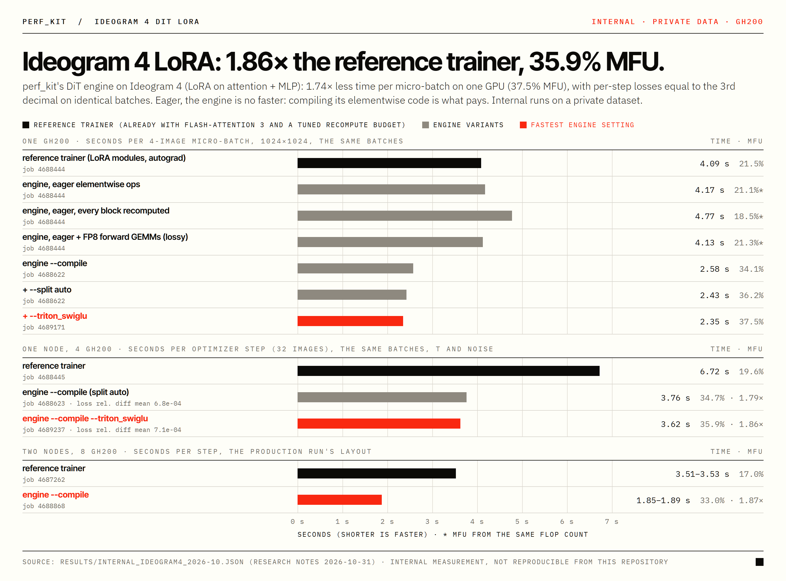

<p align="center"></p>

<p align="center"></p>

<p align="center">
  <a href="LICENSE"></a>
  
  
  
  <a href="report/index.html"></a>
</p>

# perf_kit

*By Stefan-Lucian Deleanu ([LogoLabs.org](https://logolabs.org))*

Fast, exact LoRA fine-tuning for Qwen3.5-style hybrid LLMs (Gated DeltaNet + gated attention) and dense Llama /
Qwen decoders, built and measured on NVIDIA GH200. The same approach is applied to two image models LogoLabs trains:
a LoRA engine for the **Ideogram 4** diffusion transformer ([`perf_kit/dit/ideogram4`](#ideogram-4-dit-lora)) and
the optimised training loop of **Agate**, LogoLabs' FCDM text-to-image model ([`perf_kit/t2i/fcdm`](#agate-fcdm-text-to-image)).
An advanced mode, [`perf_kit/pool`](#advanced-mode-growable-gpu-pool-perf_kitpool), trains one run on many small Slurm jobs
that join and leave at any time: it is intentionally designed to maximise the use of GPUs on partly used nodes.
A second one, [`perf_kit/elastic`](#advanced-mode-elastic-synchronous-ddp-over-tcp-perf_kitelastic), does the same with
synchronous per-step DDP over TCP between the jobs, so the run keeps the math of one big DDP job.

perf_kit is a small training engine (~2,600 lines of Python + Triton) that computes the same loss and the same LoRA
gradients as transformers + PEFT (tested in float64 against them) while removing most of the work around the
frozen GEMMs: fused projections with fused LoRA, packed variable-length batches through fla / flash-attention,
fused norms and activations, a recompute plan sized from a start-up measurement, one flat optimizer step, no host
syncs inside a step. It writes standard PEFT adapters.

## Results (public, reproducible)

Qwen3.5-9B-Base, LoRA r16 on every projection, UltraChat first turns (~530 tokens/row), the **same 64 rows per
step in every framework**, each framework at its best setting from a sweep; steady state (steps 41-60 of 60),
GH200 120GB, mean of n separate jobs:

| GPUs | trainer | setting | tokens/s/GPU (min-max) | vs perf_kit | MFU | clock-adj. MFU | SM MHz | peak GB |
|---|---|---|---|---|---|---|---|---|
| 1 | perf_kit (warm kernel cache) | 12288-token packed micro-batches | **12,523** (12,523-12,524, n=2) | 1.00x | 38.6% | 53.9% | 1418 | 81 |
| 1 | perf_kit (cold: first process on node) | 12288-token packed micro-batches | **9,993** (9,918-10,077, n=4) | 1.25x slower | 30.8% | 42.8% | 1425 | 81 |
| 1 | ms-swift 4.5.3 (padding-free, FA2, Liger) | 8 rows/micro-batch, no gradient checkpointing | **7,902** (7,728-8,010, n=3) | 1.58x slower | 24.4% | 31.2% | 1548 | 66 |
| 1 | Unsloth 2026.10.11 | 8 rows/micro-batch, gradient checkpointing | **7,115** (7,070-7,158, n=3) | 1.76x slower | 21.9% | 29.7% | 1465 | 23 |
| 1 | transformers + PEFT + FA2 + Liger | 4 rows/micro-batch, no gradient checkpointing | **5,461** (5,197-5,635, n=3) | 2.29x slower | 16.9% | 19.3% | 1738 | 82 |
| 1 | transformers + PEFT (SDPA) | 8 rows/micro-batch, gradient checkpointing | **4,511** (4,476-4,535, n=3) | 2.78x slower | 13.9% | 17.2% | 1605 | 73 |
| 4 | perf_kit (warm kernel cache) | 12288-token packed micro-batches | **12,198** (12,084-12,313, n=2) | 1.00x | 37.6% | 51.7% | 1440 | 69 |
| 4 | perf_kit (cold: first process on node) | 12288-token packed micro-batches | **6,278** (6,233-6,343, n=3) | 1.94x slower | 19.4% | 26.4% | 1455 | 69 |
| 4 | ms-swift 4.5.3 (padding-free, FA2, Liger) | 8 rows/micro-batch, no gradient checkpointing | **7,214** (7,193-7,235, n=2) | 1.69x slower | 22.2% | 27.8% | 1582 | 64 |
| 4 | transformers + PEFT + FA2 + Liger | 4 rows/micro-batch, no gradient checkpointing | **4,908** (4,882-4,934, n=2) | 2.49x slower | 15.1% | 17.0% | 1762 | 58 |
| 4 | transformers + PEFT (SDPA) | 8 rows/micro-batch, gradient checkpointing | **3,190** (3,174-3,207, n=2) | 3.82x slower | 9.8% | 11.5% | 1688 | 52 |

MFU counts `(4 N_proj + 6 N_lora) x tokens + 4 N_head x targets` FLOPs against 989 TFLOPS bf16 (attention-score
and GDN-state FLOPs not counted). The GPUs are power-capped (660 W module limit): the clock-adjusted column divides by
the SM clock the GPU actually ran at (nvidia-smi median) instead of the 1,980 MHz the peak assumes. "warm" =
Triton kernels already compiled on the node (a long job's steady state); a first process on a node spends its first
~50 steps compiling (cold rows). The two warm 1-GPU runs come from one job (same node); the cold runs and the
4-GPU runs span separate nodes. End-of-run validation loss is equal across all frameworks to 0.03%; per-step
losses match transformers + PEFT to < 6e-4.

<p align="center"></p>

27B on the same data (perf_kit only, block-FP8 checkpoint kept as FP8 codes, 1 GH200): **3,671 tokens/s, 37.6% MFU**.

**Same math, not a shortcut.** Per-step training loss tracks transformers + PEFT step for step, and every framework ends
at the same validation loss:

<p align="center"></p>

Full method, ablations, negative results and caveats: **[WRITEUP.md](WRITEUP.md)**. Raw logs: `results/raw/`;
every number above is computed by `bench/analysis/aggregate.py`.

## Install

perf_kit is a plain Python package. The engine needs only `torch`, `numpy`, `safetensors` and `transformers`;
every fast kernel is optional and falls back to a pure-PyTorch reference implementation when its library is
missing (`python -c "from perf_kit.kernels import ops; print(ops.available())"` tells you what you got).

### x86-64 (H100 / A100 / consumer GPUs)

Untested with the fast kernels: on x86 we only ran the CPU tests and the reference-kernel GPU tests (Windows, RTX 4060).

```bash
pip install torch --index-url https://download.pytorch.org/whl/cu128   # any CUDA build of torch >= 2.5
pip install -e ".[fast,test]"            # triton, flash-attn, flash-linear-attention, liger-kernel, pytest, peft
python -m pytest -q tests                # CPU exactness tests (+ GPU tests if CUDA is visible)
```

Qwen3.5 needs `transformers >= 5` (its exactness tests are skipped on older versions).

### aarch64 / GH200 (Grace Hopper)

The traps we hit, in the order you will hit them:

1. **pip silently installs a CPU-only torch on aarch64** unless you point it at a CUDA wheel index. Pin the
   index and assert afterwards: `python -c "import torch; assert torch.cuda.is_available(), torch.__version__"`.
2. **flash-attn has no aarch64 wheel**: build it (`FLASH_ATTN_CUDA_ARCHS=90 MAX_JOBS=16 pip install flash-attn
   --no-build-isolation`, ~70 GB peak RSS, needs `ninja` on PATH). If the CUDA headers your nvcc sees are older
   than nvcc itself (pip-installed nvcc vs the system toolkit), add
   `NVCC_APPEND_FLAGS=-DCCCL_DISABLE_CTK_COMPATIBILITY_CHECK`; the same flag lets fla's TileLang JIT compile.
3. **flash-linear-attention and liger-kernel are pure Python + Triton** and install anywhere
   (`pip install --target <dir>` works if you cannot modify the environment).
4. **First run JIT-compiles** fla's TileLang kernels (~1-2 min per node, cached in `~/.tilelang`) and autotunes
   Triton kernels for the first tens of steps: measure throughput after warm-up, never from step 1.
   Point `TRITON_CACHE_DIR` (and `~/.tilelang`) at a persistent shared directory so later jobs start warm: that is
   the whole difference between the cold and warm rows in the results table.
5. **One process per Grace-Hopper superchip, pinned to its own Grace**: `srun --ntasks-per-node 4
   --cpu-bind=cores` (+ `numactl --localalloc`). Kernel launches reportedly cost ~2.5x more CPU time on Grace than on a fast
   x86 host, so a rank whose host thread runs on the other socket loses real throughput.

Tested stack (GH200, Oct-Nov 2026): Python 3.13, torch 2.13.0+cu130, transformers 5.16.1, peft 0.20.0,
triton 3.7.1, flash-attn 2.8.3 (sm_90 source build), flash-linear-attention 0.5.2, liger-kernel 0.8.4;
optional flash-attn 3 (`PK_ATTN_BACKEND=fa3`). CPU tests also pass on Windows / x86 with torch 2.5.1 and
transformers 5.16.1.

## Quickstart

Data: JSONL with `{"messages": [...]}` rows (the last message is the target, the rest is rendered with the
tokenizer's chat template) or `{"prompt": ..., "completion": ...}` rows. Rows longer than `--max_len` are dropped,
never truncated.

```bash
# one GPU
python -m perf_kit.train --model /path/to/Qwen3.5-9B-Base --train train.jsonl --val val.jsonl --out runs/r16 \
    --rank 16 --alpha 32 --lr 2e-4 --warmup 50 --global_batch 64 --micro_tokens 12288 --storage bf16 \
    --chat_template_kwargs '{"enable_thinking": false}' --save_every 1000

# one node (or srun with one task per GPU: RANK / WORLD_SIZE / LOCAL_RANK are read from the environment)
torchrun --nproc_per_node 4 -m perf_kit.train ...same flags...
```

- `--storage fp8` keeps a block-FP8 checkpoint's frozen weights as FP8 codes and dequantises them exactly per
  GEMM (half the memory, same bf16 math); `bf16` for bf16 checkpoints.
- `--micro_tokens` is the packed tokens per micro-batch; the recompute plan is derived from a start-up measurement
  of the activation size (logged in the `model` event), so you mostly pick the largest value that does not need
  recompute (`tokens_without_recompute` in the log).
- SIGTERM / SIGUSR1 stop at the next log step, save `step-NNNNNN` (+ optimizer with `--optim_dir`) and exit 0;
  resume with `--init_adapter <dir> --start_step N --resume_optim --optim_dir <dir>` (bit-exact, tested).
- Adapters are PEFT format (`adapter_model.safetensors` + `adapter_config.json`): load them with peft or vLLM.
- `python -m perf_kit.gate runs/r16/log.jsonl --mfu_min 0.30 [--ref other/log.jsonl]` checks a pilot run
  (MFU, val within tolerance of a reference, GPU idle).

## Supported models

| model | engine | status | measured speed-up / MFU (source) | number is |
|---|---|---|---|---|
| **Qwen3.5 hybrid** (`model_type: qwen3_5`, Gated DeltaNet + gated attention), bf16 or block-FP8; Qwen3.5-9B-Base | `perf_kit.train` | benchmarked; used for production runs; VLM checkpoints train their text decoder | 1.58x vs ms-swift, 2.78x vs transformers + PEFT; 12,523 tokens/s, 38.6% MFU on 1 GH200 (`results/summary.json`, jobs `warm1_4806071`, `main1-3`) | **public, reproducible** from `results/raw/` |
| **Qwen3.8-27B**, block-FP8 kept as FP8 codes (`--storage fp8`) | `perf_kit.train` | benchmarked (perf_kit only); production runs | 3,671 tokens/s, 37.6% MFU on 1 GH200, public data (job `q27b_4803691`). Earlier on 4 GH200: 1.82 vs 5.155 s/step for transformers + PEFT (2.83x), 36.8% MFU (Oct 2026, `results/prior_27b_private_data.json`) | 3,671 tokens/s: **public**; the 2.83x comparison: **internal, private SFT data, not reproducible from the repo** |
| Dense **Llama 2 / 3** (incl. llama3 RoPE scaling), **Mistral** (no sliding window), **Qwen2 / 2.5** (q/k/v bias), **Qwen3** (q/k norm) | `perf_kit.train` | CPU float64-exact vs transformers + PEFT and GPU-checked on small random models; **not benchmarked on real checkpoints** | none | |
| **Ideogram 4** DiT, LoRA on attention + MLP (one adapter or timestep-binned adapters) | `perf_kit.dit.ideogram4` | CPU float64-exact vs Ideogram's own transformer definition; the engine continued a production run from step ~2,420 to its end at 9,138 (job 4690086) | 1.86x vs LogoLabs' reference trainer, 35.9% MFU (19.6% before) on 1 node of 4 GH200 (jobs 4689237 vs 4688445, 2026-10-31); 1.87x, 33.0% MFU on 2 nodes (4688868 vs 4687262) | **internal, private data, not reproducible from the repo** |
| **Agate** FCDM text-to-image (the Preview 001 / 002 generator, 190.9M parameters, 256 px) | `perf_kit.t2i.fcdm` | the loop changes are defaults of LogoLabs' Agate trainer since 2026-10-11; this repository's trainer is CPU-tested | +24% images/s in the real loop (382 to 475 img/s/GPU, generator MFU 25.1% to 31.2%; job 3650209, 2026-10-10); `--steer_upsample_once` alone +12% on the isolated step (524 to 585 img/s, 33.8% to 37.7% MFU; job 3643558) | 3650209: **internal, private captions, not reproducible from the repo**; 3643558: internal run on **synthetic inputs** (no private data), logs not in the repo |
| MoE, sliding-window attention, vision towers, MTP heads, full fine-tuning of the LLMs, QLoRA, DoRA; Agate 512 px (Preview 003), Agate LoRA | | not supported | | |

The Ideogram 4 and Agate numbers were measured with LogoLabs' internal trainers wrapped around the engine code that is
released here (`engine.py` / `ops.py`, `model.py` / `ema.py` / `text.py`); the command-line trainers in this
repository (`perf_kit.dit.ideogram4.train`, `perf_kit.t2i.fcdm.train`) are new, generic front ends, tested on CPU and
in a short smoke run on a consumer GPU, not yet on GH200.

## Ideogram 4 DiT LoRA

<p align="center"></p>

`perf_kit.dit.ideogram4` trains LoRA adapters on [Ideogram 4](https://github.com/ideogram-oss/ideogram4) with perf_kit's
techniques on a diffusion transformer: packed real tokens with flash-attention 3 varlen (no left padding computed);
fused projections (q/k/v, w1|w3) with every adapter in one GEMM and LoRA gradients accumulated in fp32 by cuBLAS; a
hand-written backward that keeps lean activations and recomputes only elementwise work; the FP8 checkpoint kept as
codes and dequantised bit-exactly per GEMM; frozen adaLN / input projections / rotary tables computed once per
micro-batch; `--split auto`, which runs a micro-batch in the fewest sub-batches that need no block recompute (exact);
one flat fused AdamW and one all-reduce per step. `--compile` compiles only the engine's elementwise functions, so
attention and the varlen layout never enter dynamo; `--triton_swiglu` reuses perf_kit's SwiGLU kernels.

Measured on GH200 (internal, private dataset, not reproducible from this repository; `results/internal_ideogram4_2026-10.json`):
**2.35 s vs 4.09 s per 4-image 1024 x 1024 micro-batch on one GPU (37.5% vs 21.5% MFU)**, 3.62 vs 6.72 s per step
on one node (1.86x, per-step losses equal to the 3rd decimal on identical batches), 1.87x on two nodes. Run eagerly the
engine is not faster than the reference; compiling its elementwise code is what pays. FP8 forward GEMMs
(`--fp8_forward`) gave no speed-up and 10x the rounding error and are not recommended.

**Licence and weights.** The weights are **not included**. Training needs Ideogram 4's weights from Ideogram's gated
Hugging Face repository (e.g. `ideogram-ai/ideogram-4-fp8`), which requires accepting the **Ideogram Non-Commercial
Model Agreement**; an adapter trained on them is a **Model Derivative** under that agreement (non-commercial use only,
distribution under its terms; commercial use needs a separate agreement with Ideogram). Ideogram's inference code is
Apache-2.0; three of its files are vendored in `perf_kit/dit/ideogram4/upstream/` as the test reference, with their
licence. Details: [`perf_kit/dit/ideogram4/NOTICE.md`](perf_kit/dit/ideogram4/NOTICE.md).

```bash
pip install git+https://github.com/ideogram-oss/ideogram4          # Ideogram's loaders (Apache-2.0)
hf auth login                                                      # after accepting Ideogram's licence on the Hub
# data: my_images/captions.jsonl with {"image": "a.png", "caption": "..."} per line
torchrun --nproc_per_node 4 -m perf_kit.dit.ideogram4.train --weights ideogram-ai/ideogram-4-fp8 \
    --data my_images --buckets 1024x1024,1024x768,768x1024 --out runs/ideo_r32 --rank 32 --alpha 32 \
    --batch_size 4 --grad_accum 2 --lr 5e-5 --max_steps 2000 --compile --triton_swiglu
```

- Adapters are PEFT format (one adapter: load with `peft` onto the package's transformer) or a binned format with
  `--n_bins > 1`. `--resume` continues exactly, in the order an uninterrupted run would have used.
- `--dataset module:function` plugs in precomputed latents + text features or another image source; `--synthetic`
  measures throughput without loading the text encoder or VAE (see `perf_kit/dit/ideogram4/data.py`).
- `EngineModule(engine)` stands in for the package's transformer, e.g. as `pipe.conditional_transformer` to sample.
- `--compile` on GH200 needs a GCC >= 13 toolchain on the node (inductor's CPU wrapper did not build with the
  system g++). The logged MFU uses the reference trainer's useful-FLOP count (`--flop_px`, 207.4 MFLOP per pixel).

## Agate FCDM text-to-image

<p align="center"></p>

`perf_kit.t2i.fcdm` holds the generator of [Agate](https://huggingface.co/Logolabs/agate-preview-002) (an FCDM
ConvNeXt-style U-Net steered by a recurrent transformer; its code was released by LogoLabs under MIT) and a trainer
with the loop changes that made it faster on GH200:

- `--steer_upsample_once`: each level's 1x1 modulation convs commute with bilinear upsampling, so the low-rank
  steering map is upsampled once per level instead of every block's 3C modulation maps (whose backward was 16% of the
  step's GPU time). Same function up to float rounding (tested); opt-in.
- `--ema_foreach` (default): the EMA as one multi-tensor lerp, bit-identical, self-checked at the first step.
- `--compile_text` (default): the frozen text encoder's forward compiled in place (parameter names unchanged).
- `--compile`, `--ddp_bucket_view` (default), `--ddp_static_graph` (single micro-batch steps only).

Measured on GH200 (internal; `results/internal_agate_2026-10.json`): in the real 256 px loop on one node, these took
the step from 0.335 to 0.270 s (**382 to 475 images/s per GPU, +24%; generator MFU 25.1% to 31.2%**; job 3650209,
synthetic latents with private captions); `--steer_upsample_once` alone made the isolated training step 12% faster
(524 to 585 images/s, 33.8% to 37.7% MFU; job 3643558, synthetic inputs). On an internal 512 px LoRA fine-tune
(private data; the LoRA recipe is not included) `torch.compile` gave 2.19x (job 3650956).

```bash
pip install -e ".[t2i]"
python -m perf_kit.t2i.fcdm.encode --images my_images --out shards --size 256     # SD-VAE latents + captions
torchrun --nproc_per_node 4 -m perf_kit.t2i.fcdm.train --init Logolabs/agate-preview-002 --data shards \
    --out runs/agate_ft --global_batch 512 --micro_batch 128 --lr 2e-5 --warmup 500 --max_steps 5000 \
    --compile --steer_upsample_once
```

`--init` loads an Agate release (generator + its fine-tuned Ettin text encoder); `--preset agate` trains the same
architecture from scratch. The final EMA is exported in Agate's release layout (`<out>/export/config.json` +
`generator.safetensors`, with the text-encoder path it was trained with). `--synthetic_hw 32` measures throughput on noise latents.

## Advanced mode: growable GPU pool (`perf_kit/pool`)

**What it is for.** An opt-in mode, intentionally designed to maximise the use of GPUs that are only partly used:
the free GPUs on partly allocated nodes and the short free windows of a busy cluster, which a job asking for whole
nodes cannot use. Many small Slurm jobs (each 1..N GPUs with ordinary DDP and perf_kit's loop optimisations inside,
at most 4 nodes) train ONE run: they join and leave at any time, a dying job costs only its unfinished round, and a
big job can join the same run when it finally starts. On Arrhenius on 2026-11-24 the scheduler estimated 2.5 h for
a 4-GPU node (those jobs actually waited 41 s to 17 min) while the small jobs waited 5 s to 2.7 min.

**How it works.** Between jobs there is no NCCL and no server: each job trains `inner_steps` local steps from the
current global weights and drops its pseudo-gradient (global minus local) into a run folder on the shared
filesystem; whoever syncs next folds the inbox into a new global version with an outer Nesterov step (DiLoCo,
Douillard et al. 2023, [arXiv 2311.08105](https://arxiv.org/abs/2311.08105)) in its asynchronous Delayed-Nesterov
form (Liu et al. 2024, "Asynchronous Local-SGD Training for Language Modeling",
[arXiv 2401.09135](https://arxiv.org/abs/2401.09135)), each contribution weighted by its samples (FedAvg's
sample-weighted mean, McMahan et al. 2017, [arXiv 1602.05629](https://arxiv.org/abs/1602.05629)), so a 2-GPU job
counts as two 1-GPU jobs. Contributions more than 4 rounds stale are dropped; nobody ever waits for a job.

**When not to use it.**
- Short runs. With few outer rounds the outer momentum has nothing to average: at 400 k samples (6 outer rounds) the
  pool reached 1.577 bits/byte against 1.365 for DDP (table below); the runs that matched DDP completed 8-13 outer
  rounds. Plan for at least that many (a hypothesis from one run per point, not a measured threshold).
- When whole nodes start quickly. Synchronous DDP is simpler and cost 7% fewer GPU-hours in the comparison (every
  pool job pays its own start-up and final evaluation, and 4-9% of trained samples were never applied).
- Without an early check of the averaged model. Untuned outer settings (lr 0.7, momentum 0.9, H = 500) failed on a
  104 M-parameter conv VAE (real use below) while every worker's own training loss looked fine. Validate the
  exported global weights (`pool.load_global`) early against a short DDP run from the same start before committing
  GPU-hours.
- Very large models without tuning: every round writes the delta and reads the newest weights over the shared
  filesystem (0.7-0.9 s at 85 M parameters; larger models were not measured).

**How to launch.** In the training loop:

```python
from perf_kit.pool import Pool
pool = Pool("/shared/runs/my_run", model, inner_steps=500, total_samples=50_000_000, gpus=world_size,
            step_samples=global_batch, max_gpus=16)       # joins (or creates) the run, pulls the global weights
if pool.full or pool.done:
    raise SystemExit                                      # the pool already holds max_gpus, or the run is over
while not pool.done:
    loss = train_step(model, batch(seed=pool.seed()))     # the seed differs per job and per round
    set_lr(schedule(pool.progress_est)                    # pool-wide progress: a late joiner does not restart
           * min(1.0, (pool.local_steps + 1) / 200))      # ... plus a local warm-up for its fresh inner optimizer
    pool.sync(model, global_batch)                        # every inner_steps calls: publish, apply, pull
pool.close(model)                                         # publishes the partial round and leaves
pool.load_global(model)                                   # the final weights (heavy-ball iterate) to evaluate / ship
```

Then keep the run topped up with small jobs under a GPU cap and a hard GPU-hour budget (no torch needed, it runs on
a login node and counts only its own job ids):

```bash
export SITE_ENV=/path/site_env.sh REPO=$PWD POOL_SCRIPT=my_train.py POOL_ARGS="--pool_run /shared/runs/my_run ..."
python -m perf_kit.pool.launch --run /shared/runs/my_run --sbatch bench/pool/pool_job.sbatch --gpus 1 \
    --max_gpus 16 --max_pending 2 --budget_gpu_hours 20 --loop 300 -- -A <account> -p <partition>
```

`bench/pool/pool_job.sbatch` runs one pool job (one task per GPU, site specifics from `$SITE_ENV`, see
`bench/slurm/site_env.example.sh`; energy monitor on local rank 0 when `$PERUN` is set); `POOL_TOPUP` lets each job
submit the next one itself. `perf_kit/pool/example_lm.py` is the worked example (a byte-level GPT, DDP or pool mode,
same code). Work only one job should do, such as validation every N versions, goes through `pool.claim(name)`,
which survives the job that would have done it leaving.

**Pitfall: schedule by `progress_est`, and warm up by local steps as well.** `pool.progress` is exact but counts
only the samples the pool has applied plus this job's own: until a job's first outer sync it cannot see the other
jobs' rounds, so a warm-up driven by it runs the whole first round as if the pool were one job (in the real run
below, the first 500 local steps trained at ~3% of the nominal learning rate). `pool.progress_est` scales the
job's unapplied samples by the pool's live round size (from the other jobs' heartbeats, refreshed at every sync and
every `done_check_every` steps); it is never below `progress` and never decreases. Pass `step_samples` to `Pool`:
a job that joined without it counts in the other jobs' round size only after its first publish, which is the very
round this estimate is for. Each joining job's inner optimizer also starts with empty moments, hence the local
warm-up (`pool.local_steps`).

**perf_kit's loop optimisations inside each job.** The pool adds nothing to the step itself: between outer syncs,
`pool.sync` only counts, and every `done_check_every` (50) steps rank 0 checks the DONE file and reads the live
jobs' heartbeats (one small JSON file per job), then broadcasts the result. The real run below used, together
with the pool: `torch.compile` of the model, no host syncs in the step (losses summed on the GPU, read at log steps),
data prepared ahead on a side CUDA stream, recompute of one branch to fit memory, `channels_last`, fused AdamW, and
DDP gradients as bucket views inside each job (its failure was in the averaged model, not in the loop).

**Measured comparison** (Arrhenius GH200, byte-level GPT of 85 M parameters, UltraChat single-turn text, bits per
byte on 2,048 fixed validation windows; DDP = one 4-GPU job; pool = four jobs of 1, 2, 1 and 2 GPUs started at
different times, the third hard-killed mid-round in every repeat; same total samples; these runs scheduled by
`progress`, before `progress_est` existed; details in [WRITEUP.md section 10](WRITEUP.md#10-advanced-mode-growable-gpu-pool-perf_kitpool)):

| run (1.2 M samples) | val bpb (pool: exported x) | pool: stored look-ahead | GPU-h | busy / idle / sync GPU-h | wall start to end | queue wait (from eligible) | samples trained / applied |
|---|---|---|---|---|---|---|---|
| DDP 4 GPUs, r1 (job 5712506) | 1.3327 | | 0.279 | 0.221 / 0.058 / 0 | 251 s | 41 s | 1.20 M / 1.20 M |
| DDP 4 GPUs, r2 (5713256) | 1.3350 | | 0.290 | 0.223 / 0.067 / 0 | 261 s | 642 s | 1.20 M / 1.20 M |
| pool 1+2+1+2, r1 (5712507-10) | 1.2955 | 1.3350 | 0.323 | 0.249 / 0.074 / 0.010 | 382 s | 41, 161, 101, 101 s | 1.34 M / 1.22 M |
| pool 1+2+1+2, r2 (5713257-60) | 1.3626 | 1.7634 | 0.301 | 0.242 / 0.060 / 0.011 | 288 s | 28, 27, 5, 5 s | 1.30 M / 1.22 M |
| pool 1+2+1+2, r4 (5714236-39) | 1.2993 | 1.3396 | 0.293 | 0.236 / 0.057 / 0.010 | 320 s | 12, 72, 12, 12 s | 1.30 M / 1.25 M |

| run (400 k samples, H = 250, starts 0 / 30 / 60 / 90 s, kill after 40 s) | val bpb | look-ahead | GPU-h | wall | queue wait |
|---|---|---|---|---|---|
| DDP 4 GPUs, r3 (5713261) | 1.3645 | | 0.142 | 128 s | 1,002 s |
| pool 1+2+1+2, r3 (5713262-65) | 1.5766 | 1.7878 | 0.134 | 150 s | 28, 58, 28, 35 s |
| pool 1+2+1+2, r5, outer momentum 0.5 (5715039-42) | 1.3975 | 1.3911 | 0.165 | 204 s | 54, 144, 54, 84 s |

On this language model, at 1.2 M samples no quality loss was measured (pool 1.296 / 1.363 / 1.299, n = 3, against DDP
1.333 / 1.335, n = 2; the pool's spread is much larger) at +7% GPU-hours; the short run lost clearly. Time from first
eligibility to the final model: DDP 292 / 903 / 1,130 s, pool 423 / 316 / 332 / 178 s.

**Real use: a failure** (2026-11-25). A 104 M-parameter convolutional image VAE (GroupNorm) at 1024 px trained as a
pool of 12 x 1-GPU + 6 x 2-GPU Slurm jobs (24 GPUs) on Arrhenius GH200 nodes that were only partly used, with
untuned outer settings (outer lr 0.7, momentum 0.9, H = 500, asynchronous Delayed Nesterov, schedule by
`progress`). Throughput and queue worked: at 03:00 CET about 87 free GPUs sat on partly allocated nodes while
whole-node jobs waited hours; the small jobs started within minutes (a 2-job smoke test within one second), trained
at ~19.6 samples/s per GPU, and 0 contributions were dropped in the first 67 global versions. Quality did not: the
run was stopped as a failure at ~22% of its length (1.34 M samples, 145 global versions, 22.4 GPU-hours). On the
exported global weights (`load_global`, the heavy-ball iterate) held-out glyphs had a worst-point median error of
2.66 px (512 px scale) with 5.9% within 5 units, and logo layers 2.40 px, 8.2% and overlap 0.869; a 2-GPU synchronous
DDP run from the same start reached ~1.0 px and 95-99% after only 48 k samples. The stored look-ahead point was worse
still (3.8 px, 0%), and the in-run validation, taken right after a pull and so on the look-ahead point, read 5.9 px /
0%. Meanwhile each worker's own training loss was low (reconstruction ~0.015, against 0.06-0.13 for the global
weights): the averaged model was much worse than the models it averaged. The cause is not established. Candidates:
outer momentum 0.9 with many asynchronous workers; H = 500 with a fresh inner AdamW in every job; the slow
progress-based warm-up of the first rounds (the pitfall above); and GroupNorm conv nets may average worse than
transformers.

**Cause found (same day): the outer momentum.** In this pool every contribution arrives about one round late
(median 0.96 rounds in the run's events), and each VAE worker re-converges within its round. Under those conditions
Nesterov momentum 0.9 overshoots, and the global weights swing with growing amplitude while every worker repairs them
locally: the workers' median reconstruction loss was ~0.012 before each sync, 0.03-0.12 in the 50 steps after the
pull, and back to ~0.015 within 100 steps, for 10 rounds without improvement. Different inits, unpooled buffers,
`_orig_mod.` / `module.` name mismatches and a bad load at evaluation were each ruled out and are now asserted at the
first pull. The pool's own `outer.apply` on a quadratic model diverges from about 5 workers up at lr 0.7 /
momentum 0.9 (4 workers sit at the edge, which is why the 4-job language-model comparison above matched DDP); with
momentum 0 it converges at every worker count tested. On a tiny version of the real VAE (24 simulated workers, CPU)
the global loss was 1.46x the workers' own and growing with 0.7 / 0.9, and 0.86x with momentum 0. A GPU proof with
the fix (3 x 1-GPU jobs, lr 1.0, momentum 0, H = 100, 144 k samples, 512 px) reached 0.906 of held-out glyphs within
5 units against 0.902 for a plain 1-GPU run of the same samples (3 workers would not have shown the old failure;
the claim for ~24 workers rests on the simulations). **Use outer momentum 0 for more than ~3 asynchronous
workers.** The default stays 0.9 so the comparison above reproduces, and the pool now logs a warning when momentum
is above 0 in asynchronous mode. A health probe (`Pool(..., probe=fn)`, `fn(model) -> loss` on a fixed batch)
writes the loss of the local and of the pulled weights at every sync to `<run>/health/<worker>.jsonl` and raises an
alarm when the median ratio of the last 5 syncs exceeds `health_warn` (1.25): on a replay of the failed run it fires
at the third sync. Two smaller defects were fixed with it: a worker still in its first round now counts in the round
size (`first_round_s`; the first 12 contributions had counted as 2.67 rounds), and the first-pull name and hash
checks above.

**Tested** (`tests/test_pool.py`, float64): with every live worker contributing once from the same base the update
equals DiLoCo's Algorithm 1 (`torch.optim.SGD(nesterov=True)` on the mean pseudo-gradient); one arrival at a time it
equals Liu et al.'s Algorithm 3; the exported weights equal the heavy-ball iterate (`SGD(nesterov=False)`); one
worker with outer lr 1 and momentum 0 equals plain training step for step; a run every worker left resumes from the
folder with samples, momentum and partial round intact; `progress_est` counts the live round (fixed or from
heartbeats), never decreases and equals `progress` for a pool of one. Simulated with real processes: a job killed
mid-round, a job killed while holding the run lock, a 100x slower job whose stale contributions are dropped while
nobody waits, DDP inside a worker (both ranks use the same learning rates), the GPU cap. Simulated in one process: a
crash between commit and inbox clean-up, a hung job that still heartbeats (a fake heartbeat file), and the
launcher's cap / pending / budget stops (fake sbatch / squeue).

## Advanced mode: elastic synchronous DDP over TCP (`perf_kit/elastic`)

**What it is for.** The same goal as the pool (use the 1-2 GPU slots a busy cluster offers within minutes), but with
ordinary synchronous data parallelism: the gradient is all-reduced at every optimizer step, so one run made of many
small Slurm jobs does the same math as one big DDP job. Jobs (1-4 GPUs each, one node each) join and leave at any
time; a crashed or hung job is dropped without stopping the others.

**Why TCP.** On an HPE Slingshot cluster every job gets its own VNI, so the fast libfabric / cxi path that NCCL uses
inside a multi-node job cannot connect two separate jobs, and a site may require multi-node jobs to take whole nodes
(on Arrhenius: at least (nodes - 1) x 4 + 1 GPUs). Plain IP over the same Slingshot interfaces does connect separate
jobs, and NCCL's own socket transport runs over it. Measured between two separate 1-GPU jobs on different nodes
(`hsn0`, NCCL defaults): 7.8 GB/s bus bandwidth, a 160 MB bf16 all-reduce in 21.6 ms (raw TCP 3.5 GB/s, gloo on CPU
1.4 GB/s). Spreading NCCL over all four `hsn` interfaces with more sockets hung on the 160 MB collective, so the mode
stays on one interface with NCCL's defaults.

**How it works.** Membership lives in files of a shared run folder (heartbeats per process, one O_EXCL claim file per
epoch so exactly one process leads it, a roster per epoch); the gradients go over NCCL, and every membership epoch is
a fresh process group. One optimizer step: backward with DDP (bf16 compression hook, `no_sync` for accumulation),
then a small control all-reduce with a timeout (alive count, join / leave / stop flags, loss and a parameter checksum
per rank); only after it succeeds does `optimizer.step()` run, so a failed step is discarded and redone on the same
data.
- **Join:** at a step boundary the group is rebuilt and the source rank broadcasts model, extra modules (EMA),
  optimizer state and counters; every rank checks a sha256 of the result.
- **Leave:** Slurm's `--signal=B:TERM@120` (a trap touches a leave file) or a deadline from `squeue %e`; the job
  finishes its step and the rest regroup. If every job leaves, rank 0 checkpoints and the next job resumes.
- **Crash / hang:** the survivors catch the `DistBackendError` (a dead peer is seen in ~0.6 s, a hung one at the
  timeout), abort the group in-process and regroup from the survivor with the highest committed step.
- **Backstops:** a stall watchdog, a split-brain guard, and `hold()` for long rank-0 work (evaluations) during which
  the other ranks wait on the TCPStore instead of inside a collective.

This follows the in-memory recovery of Elastic Horovod and torchft rather than TorchElastic's restart-all, which is
too slow for jobs that come and go every few minutes (details in
[WRITEUP.md section 11](WRITEUP.md#11-advanced-mode-elastic-synchronous-ddp-over-tcp-perf_kitelastic)).
`TORCH_NCCL_ASYNC_ERROR_HANDLING=1`, a common site default, kills the survivors on any NCCL error; the job script
sets 2 (abort the communicator, keep the process) plus `TORCH_NCCL_BLOCKING_WAIT=1`.

**Batch and lr.** With a fixed global batch (`global_micro=G`) the G micro-batches of a step are split over the ranks
and the math is the same for every world size, join, leave or crash. With a fixed per-GPU batch (`accum=k`) the
global batch is W x k x b, `el.lr_scale` is sqrt(global / `ref_batch`) (Adam; `lr_rule="linear"` for SGD), and
schedules run on global samples (`el.progress`).

**How to launch.**

```python
from perf_kit.elastic import ElasticTCP
el = ElasticTCP(model, opt, "/shared/runs/my_run", total_samples=N, micro_batch=32, global_micro=12,
                extra_modules={"ema": ema})               # joins (or founds) the run; a newcomer gets the live state
while not el.should_stop():
    with el.guard():                                      # a lost peer inside the step -> regroup, redo the step
        mis = el.micro_indices()                          # this rank's share of the step's G micro-batches
        for j, i in enumerate(mis):
            with el.accumulate(last=j == len(mis) - 1):
                el.backward(loss_fn(el.model, batch(seed, i)))
        set_lr(opt, schedule(el.progress) * el.lr_scale)
        if el.step(post_commit=update_ema) and eval_due(el.step_n):
            with el.hold("eval"):                         # the other ranks wait without a collective timeout
                if el.rank == 0:
                    evaluate()
el.close()
```

```bash
export SITE_ENV=/path/site_env.sh REPO=$PWD EL_RUN=/shared/runs/my_run EL_SCRIPT=my_train.py EL_ARGS="..."
python -m perf_kit.elastic.submit --run /shared/runs/my_run --n 8 --gpus 1 --time 06:00:00 \
    --budget_gpu_hours 50 --max_gpus 12 --stagger 60 -- -A <account> -p <partition>
```

`bench/elastic/elastic_job.sbatch` is one job (one task per GPU; NCCL on sockets over `$EL_IFACE`, default `hsn0`;
`NCCL_HOSTID` per job, so two jobs that land on one node also use sockets; no OFI plugin). A run can start from its
own checkpoint, from a pool run's newest global weights (`init_from="pool:<dir>"`), or from a weights file.
`perf_kit/elastic/example.py` is the worked example and test vehicle (the pool's byte-level GPT, elastic or
same-math reference, with hooks that kill, hang or remove a rank at a given step).

**Measured** (Arrhenius GH200, byte-level GPT of 85 M parameters, 2,000 steps x 384 windows = 768 k samples, fixed
global batch of 12 micro-batches x 32, bits per byte on 2,048 validation windows; reference = the same script on one
GPU accumulating the same 12 micro-batches):

| run | val bpb | what happened |
|---|---|---|
| reference, 1 GPU (two repeats) | 1.3134 / 1.3142 | |
| elastic, 4 separate 1-GPU jobs on 4 nodes, bf16 sync | **1.3081** | founded at world 3; one job hard-killed at step 600 (world 2); one left on Slurm's TERM at step 1,024 (world 1); one joined late at step 1,137 (world 2) |
| elastic, 2 jobs, fixed world, fp32 sync | 1.3093 | both jobs landed on one node and talked over sockets |

The first logged steps agree with the reference to 1e-4 in loss, so batch, loss scale and lr are the same math; later
the curves drift apart chaotically, as the two references also do. Both elastic runs end ~0.005 bpb lower than both
references (n = 2 per arm; not explained, and not the bf16 hook, since the fp32 run is lower too).

| world | step (ms) | sync overhead per step (ms) | speed-up vs 1 GPU |
|---|---|---|---|
| 1 | 266 | 10 | 0.96 |
| 2, bf16 | 154 | 26 | 1.66 |
| 3, bf16 | 116 | 30 | 2.21 |
| 2, fp32 | 175 | 38 | 1.57 |

| membership change | regroup time |
|---|---|
| founding, world 3 (first NCCL init 8.2 s) | 9.9 s |
| crash of one job | 18.5 s (17.5 s of it waiting for the dead job's heartbeat to expire) |
| leave on TERM | 0.5 s |
| late join | 1.4 s |

The sync cost is ~26-30 ms per step at 85 M parameters; a model with longer steps pays relatively less. **Real use**
(2026-11-26): an 80 M-parameter flow-matching font generator ran overnight as 16 x 1-GPU jobs, at most 8 at once,
grown 2 -> 3 -> 4 -> 6 -> 8 with no desync, recovery or stall event and every parameter checksum equal, at 0.50-0.58
s per step for 1,024 samples (~80-85% of 8 independent GPUs; evaluations idle the other ranks for ~10% of the time);
its validation loss fell from 0.276 to 0.183 between 1.0 M and 2.6 M samples. A whole 4-GPU node was estimated to
start ~14.5 h later.

**When not to use it.** When whole nodes start quickly (plain DDP inside one job uses NVLink and the fast fabric);
for models whose gradient is much larger than ~1 GB at this bandwidth. Not yet measured on GPUs: more than 8 ranks,
2-4 GPU jobs joining, and a hang during a real training step.

**Tested** (`tests/test_elastic.py`, CPU, gloo, real processes): a fixed world equals the same-math reference
(loss curves equal to float noise, equal checksums); worlds 1, 2, 3, 2, 3, 2 through join, join, leave, crash
(`os._exit`) and late join stay within 4e-7 in loss of the reference; a hung rank is timed out and the others
finish on the reference curve; all jobs leave and a new job resumes from the checkpoint; exactly one winner of an
epoch claim among 5 racing members; optimizer state transferred bit-identically; starting from a pool version; the
per-GPU lr rule; mismatched settings refused; a hold longer than the collective timeout; EMA updated before a
regroup (`post_commit`).

## How it works (short)

1. **Fused projections + fused LoRA, no PEFT wrappers.** Projections that read the same input (q/k/v; gate/up; the four Gated DeltaNet input projections) run as one GEMM over a concatenated weight.
2. **One flat LoRA store.** All adapters live in one fp32 master tensor (+ grad, + bf16 compute copy with B pre-scaled by alpha/r).
3. **Varlen packing without padding.** A micro-batch is one packed sequence + `cu_seqlens`: flash-attn varlen for the attention layers, fla's chunked Gated DeltaNet (native grouped value heads, gate and beta computed inside the kernel) and fla's causal conv with `cu_seqlens`.
4. **Step sets are separate from layout.** The loss is normalised by the step's global target count, so the gradient depends only on which rows the step trains, not on how they are split over ranks and micro-batches.
5. **Recompute only what memory requires, measured at start-up.** Per micro-batch, a plan checkpoints just enough layers (spread evenly) to fit the activation budget.
6. **Fused small ops.** Liger RMSNorm and residual-add + RMSNorm (one kernel each way), an own SwiGLU kernel that reads the fused gate|up output in place and writes the fused gradient, fla's gated RMSNorm, `torch.split` instead of slicing (a slice's backward zero-fills and copies a full-size gradient), a chunked frozen LM head + cross-entropy that never materialises `[tokens x vocab]` logits and runs only at target positions.
7. **No host syncs inside a step.** Losses and counters accumulate on the GPU and are read at log steps; micro-batches are packed and pinned on a CPU thread and copied on a side stream.
8. **Block-FP8 checkpoints kept as FP8 codes** (`--storage fp8`), dequantised bit-exactly to bf16 right before each GEMM by a Triton kernel (~2.9 TB/s on GH200): the same bf16 weights in half the memory.

What each one is worth, measured by switching it off (two jobs per arm for most):

<p align="center"></p>

Each item, its measured contribution and what did not pay: [WRITEUP.md](WRITEUP.md); the full technical report is
[report/index.html](report/index.html).

Opt-in, measured but not default: `PK_ATTN_BACKEND=fa3` (flash-attention 3), `PK_GDN_BACKEND=flashqla`, `FastQwen35(fp8_forward=True)`
(lossy FP8 GEMMs), `--act_offload` (exact activation offload to host memory, experimental), and `PK_DISABLE=...` to
force any fast kernel onto its reference path. See WRITEUP.md for what each is worth.

## Tests

```bash
python -m pytest -q tests        # CPU: exactness vs transformers + PEFT (float64), layout, packing, FP8 dequant,
                                 # planner, CLI end to end incl. stop / resume, benchmark-harness parity;
                                 # GPU tests run automatically when CUDA is visible
python bench/gpu_equiv.py --out r.json   # one GPU: fast kernels vs transformers + PEFT at realistic head shapes
```

On a GH200 node (with fla, flash-attn, Liger and FA3 installed) the 31 LLM tests of 0.1.0 pass. The Ideogram 4 and
Agate tests (`tests/test_ideogram4.py`, `tests/test_fcdm.py`: float64 exactness of the DiT engine against Ideogram's
transformer definition, recompute / split exactness, PEFT adapter round trip, the steer-once identity, bit-identical
foreach EMA, end-to-end runs with exact resume; with Ideogram's package installed, the engine on a model built by its
FP8 loader) run on CPU, as do the pool and elastic tests (`tests/test_pool.py`, `tests/test_elastic.py`, with
real worker processes; on Windows set `USE_LIBUV=0`); on a Windows /
x86 box with torch 2.5.1 and transformers 4.57.6 the whole suite gives 62 passed, 5 skipped.

## Benchmark

`bench/` holds everything needed to rerun the comparison: data preparation (`bench/data`), one harness per framework
on identical step sets (`bench/e2e`), Slurm launchers with site specifics factored out (`bench/slurm`), and the
analysis that produces every table and figure (`bench/analysis`). See "How to reproduce" in WRITEUP.md.

## Limitations

GH200-only numbers (no H100 / A100 / B200 measurements), LoRA only for the LLMs, Qwen3.5-architecture models
benchmarked (dense families only tested for exactness), single node, short runs, and at 9B on one GPU perf_kit is
launch-bound on the Grace CPU. The Ideogram 4 and Agate numbers are internal (private data or logs not in the
repository) and were measured with internal trainers around the released engine code; the released trainers for
them have not run on GH200 yet. Details in WRITEUP.md.

## Citation

See `CITATION.cff`.

## Licence

Apache-2.0 (see `LICENSE` and `NOTICE`). `perf_kit/dit/ideogram4/upstream/` is Ideogram, Inc.'s Apache-2.0 code
(`perf_kit/dit/ideogram4/LICENSE-IDEOGRAM4-CODE`); Ideogram 4's **weights are not included and not covered** by
either licence (Ideogram Non-Commercial Model Agreement, see `perf_kit/dit/ideogram4/NOTICE.md`). The Agate generator
code in `perf_kit/t2i/fcdm/model.py` was first released by LogoLabs under MIT (`perf_kit/t2i/fcdm/LICENSE-AGATE`).

## Acknowledgements

<p align="center"></p>

**We acknowledge EuroHPC JU for awarding the project ID EHPC-AIF-2026PG01-907 access to resources on Arrhenius GPU
at NAISS, Sweden.** perf_kit was built, tested and benchmarked under that EuroHPC AI Factory allocation.

perf_kit stands on [flash-linear-attention](https://github.com/fla-org/flash-linear-attention),
[flash-attention](https://github.com/Dao-AILab/flash-attention), [Liger Kernel](https://github.com/linkedin/Liger-Kernel),
[Triton](https://github.com/triton-lang/triton), [PEFT](https://github.com/huggingface/peft) and
[transformers](https://github.com/huggingface/transformers); the comparison runs [ms-swift](https://github.com/modelscope/ms-swift)
and [Unsloth](https://github.com/unslothai/unsloth) at their best settings we could find. Thank you to all of them.
