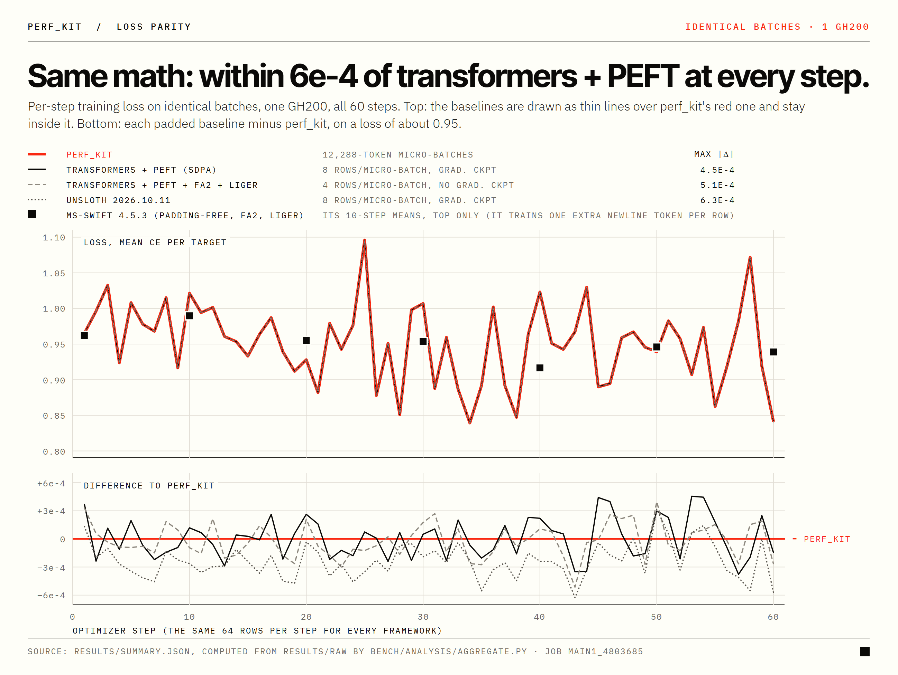

# Making LoRA on a hybrid Gated-DeltaNet LLM fast on GH200, measured

*perf_kit 0.1.0, November 2026. Every number below is reproducible from this repository (`results/raw/` holds the
logs, `bench/analysis/` turns them into the tables and figures). Where a number comes from earlier internal runs on
private data, it is labelled as such.*

**TL;DR.** On Qwen3.5-9B-Base (LoRA r16 on every projection, public UltraChat data, identical 64-row steps for
every framework), perf_kit trains at **12,523 tokens/s per GH200 on 1 GPU and 12,198 per GPU on one
4-GPU node, 37.6% MFU** (conservative FLOP count, 989 TFLOPS peak; ~52% at the clock the
power-capped GPUs actually ran). The best tuned baseline we found is ms-swift without gradient checkpointing on 1
GPU (7,902 tokens/s, 1.58x slower) and ms-swift 4.5.3 (padding-free, FA2, Liger) on 4 GPUs (7,214 tokens/s/GPU, 1.69x).
Losses match transformers + PEFT step by step (differences < 6e-4 on a loss of ~0.95; end-of-run val equal to
0.03%). Most of the gain comes from removing work around the GEMMs, not from new kernels; several things we
expected to help did not, and are listed with numbers. All of it is GH200-only: no H100 numbers.


## 1. The problem

Qwen3.5 (and the larger Qwen3.8-27B we trained most) is a *hybrid* decoder: three of every four layers are Gated
DeltaNet (GDN) linear-attention layers (a gated delta-rule recurrence computed in chunks, preceded by a short causal
convolution), the fourth is gated softmax attention. LoRA fine-tuning freezes all base weights and trains low-rank
adapters on every projection. That combination has a cost structure most training stacks are not built for:

- **The useful FLOPs are almost all frozen GEMMs.** Per token the frozen projections cost 2N in the forward and 2N
  for the input gradient; no weight gradient is needed. LoRA adds ~0.8% of the FLOPs at r16 on the 9B, ~5% at r128
  on the 27B. The job is to keep the frozen GEMMs running back to back; everything else on the GPU timeline is
  overhead.
- **The standard stack runs GDN padded.** transformers uses fla's Triton kernels for the GDN recurrence when fla
  is installed, but its short convolution falls back to a PyTorch `conv1d` unless the `causal-conv1d` package is
  present (no aarch64 wheel), and that fallback cannot respect row boundaries in packed batches. So padded batches
  it is.
- **PEFT's LoRA wrappers are launch-heavy.** Each adapted Linear becomes several kernels plus autograd bookkeeping
  in both directions, and fp32 adapters under bf16 autocast are re-cast at every forward (and again in recompute).
- **Grace dispatches slowly.** PyTorch op dispatch on the Grace CPU is reported at ~2.5x the cost of a fast x86
  host (Transformer Engine issue #2053), so launch-bound code that is invisible on an x86 H100 node shows up as GPU
  idle time on GH200.
- **The GPUs run power-capped.** The GH200 module limit on our cluster is 660 W (GPU + Grace + memory). Under
  training load the SM clock sits at 1.4-1.8 GHz, not the 1.98 GHz the 989 TFLOPS bf16 peak assumes, and the
  software power cap is active in 82-100% of samples in every arm. Faster code draws more power and runs at a *lower*
  clock (perf_kit ~1.43 GHz, the padded baselines 1.55-1.80 GHz). We therefore report MFU against the nominal peak
  and a clock-adjusted MFU (MFU x 1980 / measured median SM MHz).

Before writing any code we profiled the plain transformers + PEFT trainer on the 27B: 11-14% MFU, GPU idle 29% of
the time, copies and casts 25% of kernel time, while the GEMMs themselves already ran at ~620 TFLOPS. The kernels
were fine; everything around them was not.

## 2. What perf_kit does

A LoRA step on a frozen base is dominated by the frozen projections' GEMMs (forward + input gradient, 4N FLOPs
per token). Everything perf_kit does either keeps those GEMMs fed or removes work around them. Each item below is
exact (same math as transformers + PEFT up to float summation order) unless marked otherwise, and is covered by a
CPU float64 test against transformers + PEFT.

1. **Fused projections + fused LoRA, no PEFT wrappers.** Projections that read the same input (q/k/v;
   gate/up; the four Gated DeltaNet input projections) run as one GEMM over a concatenated weight. All LoRA A
   matrices of a group run as one GEMM, each B is added with one `addmm` into the base output. LoRA weights are not
   autograd leaves: the backward accumulates their gradients straight into fp32 buffers with
   `torch.addmm(acc, a, b, out_dtype=torch.float32, out=acc)` (one cuBLAS call, no bf16 rounding of the
   per-micro-batch gradient, no AccumulateGrad nodes, no per-step re-cast of fp32 LoRA weights under autocast).
2. **One flat LoRA store.** All adapters live in one fp32 master tensor (+ grad, + bf16 compute copy with B
   pre-scaled by alpha/r). The optimizer is a single fused AdamW over one tensor, the gradient all-reduce is one
   NCCL call, refreshing the compute copies after a step is two kernels.
3. **Varlen packing without padding.** A micro-batch is one packed sequence + `cu_seqlens`: flash-attn varlen
   for the attention layers, fla's chunked Gated DeltaNet (native grouped value heads, gate and beta computed
   inside the kernel) and fla's causal conv with `cu_seqlens`. Targets never cross row boundaries and positions
   restart per row. (transformers' PyTorch conv fallback ignores row boundaries in padding-free batches, so a
   packed row would see its neighbour's last 3 tokens; perf_kit's packed result equals the rows run one by one,
   tested.)
4. **Step sets are separate from layout.** The loss is normalised by the step's global target count, so the
   gradient depends only on which rows the step trains, not on how they are split over ranks and micro-batches.
   The step set comes from a reproducible sampler; rows are then dealt to ranks longest-first onto the least
   loaded rank (LPT) and packed first-fit-decreasing into token-budget micro-batches. On our long-tailed 4-GPU
   workload this cut the rank straggler tax from 12-23% of every step to under 1%.
5. **Recompute only what memory requires, measured at start-up.** Per micro-batch, a plan checkpoints just
   enough layers (spread evenly) to fit the activation budget. The per-token activation size is measured on the
   real model with one probe forward when training starts (new in this release; the previous fixed estimate of
   0.25 MiB/token/layer over-stated the Qwen3.5-9B's measured 0.157-0.158 by ~60% and made recompute start with a
   third of the HBM still free).
6. **Fused small ops.** Liger RMSNorm and residual-add + RMSNorm (one kernel each way), an own SwiGLU kernel
   that reads the fused gate|up output in place and writes the fused gradient, fla's gated RMSNorm,
   `torch.split` instead of slicing (a slice's backward zero-fills and copies a full-size gradient), a chunked
   frozen LM head + cross-entropy that never materialises `[tokens x vocab]` logits and runs only at target
   positions.
7. **No host syncs inside a step.** Losses and counters accumulate on the GPU and are read at log steps;
   micro-batches are packed and pinned on a CPU thread and copied on a side stream.
8. **Block-FP8 checkpoints kept as FP8 codes** (`--storage fp8`), dequantised bit-exactly to bf16 right before
   each GEMM by a Triton kernel (~2.9 TB/s on GH200): the same bf16 weights in half the memory. At 27B this freed
   ~27 GB and removed nearly all recompute. (The 9B benchmark checkpoint is bf16, so this does not apply there.)

## 3. What each piece is worth (ablations)

One model load, then the same 16 steps (64 rows each) per configuration from the same LoRA init with a fresh
optimizer; median step time of the last 10 steps; every step CUDA-synchronised; 1 GH200; 8,192-token
micro-batches; two independent jobs on different nodes for most configurations. Reference: the full engine
(2.90 s/step, median of two runs). The first configuration of each job is excluded (it absorbs the process's JIT
warm-up and ran 4-5% slow both times).


| removed / replaced (one at a time) | step time vs full engine | n |
|---|---|---|
| recompute every layer (what a standard trainer does) | +41.2% (+41.2) | 1 |
| per-row PyTorch conv instead of fla's varlen causal conv | +20.2% (+20.3, +20.1) | 2 |
| PyTorch RMSNorm / add + norm instead of Liger | +14.5% (+14.7, +14.4) | 2 |
| per-row eager attention instead of flash-attn varlen | +12.5% (+12.4, +12.6) | 2 |
| PyTorch SwiGLU instead of the fused gate|up kernel | +9.9% (+9.9) | 1 |
| PyTorch gated RMSNorm instead of fla's | +7.5% (+7.5) | 1 |
| bf16 LoRA grads + separate add instead of fp32-accumulating addmm | +0.7% (+0.7) | 1 |
| flash-attention 3 instead of 2 | -0.1% (-0.1, -0.1) | 2 |
| FlashQLA GDN kernels instead of fla | -1.0% (-1.1, -0.8) | 2 |
| GDN gate / beta in PyTorch instead of inside fla's kernel | -4.9% (-5.7, -4.1) | 2 |

Per-step losses agree across all configurations to the 3rd-4th decimal (bf16 summation order), which is the
numerical check that each piece is exact.

Two results we did not expect:

- **fla's in-kernel gate is slower here.** Computing the GDN gate `g = -exp(A_log) * softplus(a + dt_bias)` and
  `beta = sigmoid(b)` in PyTorch and passing them to fla was 4.1% and 5.7% *faster* (two runs) than fla's
  `use_gate_in_kernel` path, which perf_kit used by default. We left the default alone because the 27B was not
  re-measured; `PK_DISABLE=gdn_fused_gate` switches it.
- **FA3 and FlashQLA change nothing end to end on the 9B** (-0.1% and -1.0%, inside run-to-run noise), although FA3
  is 12% faster than FA2 as an isolated kernel at the 27B's shapes and FlashQLA is 17% slower than fla there. At 9B
  attention is ~1.5% and GDN ~8% of GPU time; a kernel win there cannot move the step by much.


Two bugs we found while preparing the release (both fixed, both with tests):

- **The "reference" GDN path was not the reference.** transformers 5.16 routes the name
  `torch_chunk_gated_delta_rule` to fla's Triton kernel whenever fla is importable, even for CPU tensors. perf_kit's
  pure-PyTorch reference imported that name, so on machines with fla installed the "fast vs reference" layer
  benchmark compared fla with fla (an earlier internal 1.8x "fast vs ref" figure was really ~23x: 46 vs 1,086 ms per
  four 27B-width layers) and the CPU exactness tests crashed. The reference now unwraps to transformers' own
  PyTorch function, and the tests do the same for transformers' model.
- **The recompute planner over-estimated activations** (next section).

### The planner fix

perf_kit decides per micro-batch how many layers to recompute so that stored activations fit the free HBM. It used
a fixed 0.25 MiB per token per layer; the 9B actually stores 0.157-0.158 MiB (measured at start-up in every run),
so recompute kicked in at ~7.3k tokens with a third of the HBM free. The release measures it on the real model with
one probe forward (`engine.measure_act_mb`, CUDA allocator count after a warm-up forward, tested against a real
step) and plans with the measurement x 1.05.


At 12,288-token micro-batches the old estimate recomputes 28.5% of the layers (3.03-3.09 s/step); the measured plan
recomputes none (2.70-2.76 s/step): **11-12% faster at the same batch**, and it makes the fastest setting (10-12k
tokens) reachable without hand-tuning. Past ~12.4k tokens the HBM really is full and recompute starts (16k tokens:
19.5% recomputed, 3.14 s). On the 27B the same measurement gives 0.216 MiB/token/layer, i.e. no recompute up to
~3.7k tokens on one GPU with FP8-stored weights.

## 4. What did not work (and why)

| idea | what we measured | verdict |
|---|---|---|
| FP8 forward GEMMs (vLLM CUTLASS block-scaled, `FastQwen35(fp8_forward=True)`, API only) | 1.1-1.5x per GEMM in isolation incl. activation quantisation, ~3.7% relative output error; in situ at 27B the step got slower (9.5 vs 6.9 s) | off by default, lossy, A/B only |
| FP8 via `torch._scaled_mm` | block (1x128 / 128x128) scales rejected; one accepted layout returned garbage (rel. err 1.7e5); row-wise worked but the whole step ran at 0.71x of bf16 | not used |
| torchao float8 row-wise | 3-4x slower than bf16 per projection (eager) | not used |
| FlashQLA (TileLang GDN kernels) | 17% slower than fla's GDN fwd+bwd at the 27B shapes (kernel A/B), slightly larger error; end to end on the 9B -1.0% step time (n=2, inside noise) | `PK_GDN_BACKEND=flashqla`, not default |
| flash-attn 3 | 12% faster attention kernel at the 27B shapes, same error; end to end on the 9B -0.1% (n=2): attention is ~1.5% of GPU time | opt-in `PK_ATTN_BACKEND=fa3` |
| fla's in-kernel GDN gate (`use_gate_in_kernel`, our default) | 4.4-5.3% *slower* than computing gate / beta in PyTorch on the 9B (n=2), identical losses | kept default until re-measured at 27B; `PK_DISABLE=gdn_fused_gate` |
| fp32-accumulating LoRA-gradient addmm | replacing it with bf16 grads + add: +0.7% step time at r16 (noise); kept for accuracy (no bf16 rounding of per-micro-batch grads), not speed | kept |
| CUDA graphs / regional compile | GPU idle ~2-5% with the fused path at 27B | not pursued at 27B (might pay at small models) |
| activation offload to Grace memory (`--act_offload`) | bit-identical (tested); the only in-situ trial (27B, 1 GPU) ran out of host memory (~102 GB per GPU job) and, with 1.5x micro-batches, out of HBM | experimental, no measured speed-up |
| adaptive recompute without freeing memory first | slower than fixed recompute in the old trainer | superseded by the measured plan |

## 5. The comparison

### Setup

- **Model / data**: Qwen3.5-9B-Base (bf16 checkpoint), LoRA r16 / alpha 32 on every projection of the text decoder
  (in_proj_qkv, in_proj_z, out_proj, q/k/v/o, gate/up/down: 40,108,032 trainable parameters, identical in every
  framework, checked). First user/assistant exchange of each conversation of
  [HuggingFaceH4/ultrachat_200k](https://huggingface.co/datasets/HuggingFaceH4/ultrachat_200k) (MIT), rows in file
  order; 530 tokens per row on average, 64% of tokens trained; Qwen chat template with thinking disabled.
- **Identical work**: step s trains rows `[64 s, 64 s + 64)` in every framework; the same token ids (ms-swift's
  first 256 ids checked equal; swift additionally trains the newline after `<|im_end|>`, +1 token per row, counted
  in its throughput); the same init adapter (checksum logged by every harness); lr 2e-4, 6 warm-up steps, cosine to
  0.1x over 60 steps (swift: transformers' `cosine_with_min_lr`, offset by one step); AdamW (0.9, 0.99), no weight
  decay, clip 1.0; loss normalised by the step's global target count.
- **Each framework at its best**: we swept micro-batch size and gradient checkpointing for each baseline (the
  failed or slower settings are in `results/summary.md`) and gave them the same fast kernels where they accept
  them: flash-attention 2 (sm_90 build), Liger RMSNorm / SwiGLU / fused linear-CE, fla's GDN kernels. Padded arms
  sort each step's rows by length before forming micro-batches. Unsloth uses its own patched model, LoRA wrapper
  and offloaded checkpointing inside the same (padded) training loop.
- **Launch**: every arm the same way: one process per GPU pinned to its own Grace (`srun --cpu-bind=cores`,
  `numactl --localalloc`), energy-monitored with perun, nvidia-smi sampled at 1 Hz.
- **Metric**: real (unpadded) tokens per second per GPU over steps 41-60 of a 60-step run; MFU with
  `(4 N_proj + 6 N_lora) x tokens + 4 N_head x targets` FLOPs (attention-score and GDN-state FLOPs not counted, so all
  MFUs are slight under-estimates) against 989 TFLOPS. Repeats are separate jobs on different nodes.

### Results

| GPUs | trainer | setting | n | tokens/s/GPU steps 41-60 (min-max) | steps 11-60 | MFU | clock-adj. | SM MHz | padding | peak alloc GB | val @60 |
|---|---|---|---|---|---|---|---|---|---|---|---|
| 1 | perf_kit (warm) | 12288-token packed micro-batches | 2 | 12,523 (12,523-12,524) | 12,484 | 38.6% | 53.9% | 1418 | 0% | 81.0 | 0.9677 |
| 1 | perf_kit (cold) | 12288-token packed micro-batches | 4 | 9,993 (9,918-10,077) | 8,065 | 30.8% | 42.8% | 1425 | 0% | 81.0 | 0.9677 |
| 1 | ms-swift 4.5.3 (padding-free, FA2, Liger) | 8 rows/micro-batch, no gradient checkpointing | 3 | 7,902 (7,728-8,010) | 6,213 | 24.4% | 31.2% | 1548 | 0% | 65.9 | 0.9678 |
| 1 | Unsloth 2026.10.11 | 8 rows/micro-batch, gradient checkpointing | 3 | 7,115 (7,070-7,158) | 7,073 | 21.9% | 29.7% | 1465 | 14% | 22.7 | 0.9675 |
| 1 | Unsloth 2026.10.11 | 16 rows/micro-batch, gradient checkpointing | 1 | 6,924 (6,924-6,924) | 6,134 | 21.4% | 29.1% | 1455 | 26% | 27.7 | 0.9675 |
| 1 | transformers + PEFT + FA2 + Liger | 4 rows/micro-batch, no gradient checkpointing | 3 | 5,461 (5,197-5,635) | 5,455 | 16.9% | 19.3% | 1738 | 6% | 82.5 | 0.9678 |
| 1 | transformers + PEFT + FA2 + Liger | 16 rows/micro-batch, gradient checkpointing | 3 | 4,823 (4,779-4,868) | 4,766 | 14.9% | 18.9% | 1555 | 26% | 71.4 | 0.9677 |
| 1 | transformers + PEFT (SDPA) | 8 rows/micro-batch, gradient checkpointing | 3 | 4,511 (4,476-4,535) | 4,486 | 13.9% | 17.2% | 1605 | 14% | 73.4 | 0.9676 |
| 4 | perf_kit (warm) | 12288-token packed micro-batches | 2 | 12,198 (12,084-12,313) | 12,161 | 37.6% | 51.7% | 1440 | 0% | 69.3 | 0.9676 |
| 4 | ms-swift 4.5.3 (padding-free, FA2, Liger) | 8 rows/micro-batch, no gradient checkpointing | 2 | 7,214 (7,193-7,235) | 6,437 | 22.2% | 27.8% | 1582 | 0% | 64.4 | 0.9678 |
| 4 | perf_kit (cold) | 12288-token packed micro-batches | 3 | 6,278 (6,233-6,343) | 6,785 | 19.4% | 26.4% | 1455 | 0% | 69.3 | 0.9677 |
| 4 | transformers + PEFT + FA2 + Liger | 4 rows/micro-batch, no gradient checkpointing | 2 | 4,908 (4,882-4,934) | 4,836 | 15.1% | 17.0% | 1762 | 17% | 58.0 | 0.9677 |
| 4 | transformers + PEFT (SDPA) | 8 rows/micro-batch, gradient checkpointing | 2 | 3,190 (3,174-3,207) | 3,057 | 9.8% | 11.5% | 1688 | 34% | 52.2 | 0.9678 |
| 4 | transformers + PEFT + FA2 + Liger | 16 rows/micro-batch, gradient checkpointing | 2 | 2,697 (2,681-2,713) | 2,609 | 8.3% | 9.6% | 1718 | 54% | 71.7 | 0.9678 |

Settings tried and dropped (see results/summary.md): transformers + PEFT with 16 rows (OOM: fp32 logits), FA2 + Liger without checkpointing at 8 / 16 rows (OOM), ms-swift with checkpointing at 8 / 16 rows (4.6-5.1k tokens/s, 24-step tuning runs).

**Cold vs warm.** perf_kit's first process on a node spends its first ~50 steps JIT-compiling Triton kernel
specialisations for the packed lengths it meets (fla, Liger and our kernels); later processes on the node reuse the
on-disk cache and are at full speed from step ~10. Steps 41-60 of a cold run still contain compilation (row
"cold"); a warm-cache run is the steady state of a long job. ms-swift and Unsloth also warm up for 20-30 steps (their
steps 41-60 are past it); the transformers arms are flat from step 10. In a multi-hour run the compile cost is a
few minutes once; for short runs, point `TRITON_CACHE_DIR` at persistent storage.

**Padding.** The padded arms (transformers + PEFT and Unsloth in the same loop) spend 6% (FA2 + Liger, 4 rows), 14%
(SDPA, 8 rows), 14% (Unsloth, 8 rows), 26% (FA2 + Liger, 16 rows) of their token slots on padding on 1 GPU, although
each step's rows are sorted by length before forming micro-batches (the best a padded trainer can do without
changing which rows a step trains). Even with zero padding (measured throughput divided by the real-token share) the
best of them (Unsloth, 8 rows) would reach ~8,225 tokens/s on 1 GPU; perf_kit (warm) is still 1.52x faster.

**Scaling.** perf_kit keeps its per-GPU throughput from 1 to 4 GPUs (LPT dealing + one all-reduce per step).
The padded arms lose 10-45% per GPU at 4 GPUs because each rank then sees only 16 rows of a 64-row step, so its
micro-batches pad more (up to 54% padding) and the fixed per-step costs are amortised over less work.



**Same math.** Per-step training losses of perf_kit and transformers + PEFT (with and without FA2 + Liger)
differ by less than 6e-4 at every step, and those of perf_kit and Unsloth by at most 6.3e-4 (bf16 noise), start from the same value (step-1 loss
0.9651-0.9656) and end at the same validation loss (0.96749-0.96778 across all five frameworks; base model
1.0454-1.0456). A CPU test runs the same two harnesses on a tiny Qwen3.5 checkpoint in float32 and requires equal
per-step losses to 2e-5 relative (`tests/test_bench_parity.py`); perf_kit's kernels are separately tested against
transformers + PEFT in float64 (CE and every LoRA gradient, 1e-6 / 1e-5).

### 27B on public data

perf_kit only (no baseline re-run at 27B; see `results/prior_27b_private_data.json` for the earlier comparison on
private data): Qwen3.8-27B with its block-FP8 checkpoint kept as FP8 codes (dequantised exactly per GEMM, 28.5 GB
of frozen weights), 1 GH200, same data and LoRA r16: **3,671 tokens/s, 37.6% MFU** (53% clock-adjusted at
1,395 MHz) with 3,600-token micro-batches and no recompute; 6,144-token micro-batches need 40% recompute and are
12% slower.

Earlier (October 2026, private SFT data, r128, 4 GH200, 300 identical steps): transformers + PEFT 5.155 s/step,
ms-swift 3.70 s/step (with gradient checkpointing), perf_kit 1.82 s/step (36.8% MFU by the 4 x 27e9 convention),
validation loss 0.6866 / 0.6878 / 0.6863. The swift number there used gradient checkpointing; on the 9B, swift is
1.7x faster without it, which we did not try at 27B, so read that comparison as an upper bound on perf_kit's
advantage at 27B.

### Where the time goes now

A torch.profiler capture of two steps (1 GH200, 9B, 8,192-token micro-batches): GEMMs 69% of GPU kernel time, fla
GDN 8%, copies/casts 7%, causal conv 3.4%, norms 3.2%, everything else under 3% each; ~20,200 kernel launches per
step, and the host spends about as long issuing ops as the GPU spends executing them. At 9B on one GH200 perf_kit is
**launch-bound on the Grace CPU**: the remaining lever is CUDA graphs / fewer launches, not faster kernels. (At 27B
the larger GEMMs hide the host; GPU idle was ~2-5% there.) The GEMMs run at ~480 TFLOPS over the step, about 68% of
what the power-capped clock allows.

## 6. Limitations

- **One machine type.** Every number is from NVIDIA GH200 120GB superchips (96 GB HBM3 per GPU) on one cluster,
  where the module is power-capped at 660 W and the SM clock under load sits at ~1.4-1.8 GHz. We have **no H100
  / A100 / B200 numbers**; x86 hosts dispatch kernels faster than Grace, which helps launch-bound baselines more
  than perf_kit, so the speed-up there is probably smaller. The design is not GH200-specific, the tuning is.
- **LoRA only.** No full fine-tuning, no QLoRA / 4-bit base, no DoRA / rsLoRA, no dropout on the adapter path
  (perf_kit's fused LoRA assumes dropout 0, the setting most LoRA SFT recipes use).
- **Model coverage.** Fast paths exist for the Qwen3.5 hybrid family (Gated DeltaNet + gated attention; tested on
  the 9B and a 27B checkpoint) and for Llama / Mistral / Qwen2 / Qwen3 dense decoders. The dense models are
  CPU-exact and GPU-checked against transformers + PEFT but **not benchmarked on a real checkpoint**.
  Sliding-window attention, MoE layers, vision towers and multi-token-prediction heads are not trained.
- **Text SFT on short rows.** The public benchmark rows average ~530 tokens (single-turn UltraChat). Very long
  sequences shift the balance towards attention / GDN kernels, where perf_kit uses the same kernels the
  baselines can use.
- **Single node.** The benchmark covers 1 GPU and 4 GPUs (one node). perf_kit has run on 2 nodes in production
  (NCCL over Slingshot), but there is no controlled multi-node comparison here.
- **Baselines at their best on this machine, not everywhere.** We tuned micro-batch size and gradient
  checkpointing for each baseline (sweep in the results) and gave them the same fast kernels where they accept
  them (flash-attention 2, Liger, fla's GDN). transformers cannot use padding-free batches for Qwen3.5 here
  without the `causal-conv1d` package (no aarch64 wheel), so its arms are padded (length-grouped); ms-swift runs
  padding-free. Newer releases of any of them may be faster.
- **Short runs.** Throughput is measured over steps 41-60 of 60-step runs, repeated across jobs; loss parity over
  60 steps. That shows the math is the same, not that long runs converge the same. perf_kit has trained
  multi-thousand-step production runs (27B and 9B, private data, up to 2 nodes) at ~36-37% MFU, but those are not
  part of this benchmark.
- **Energy.** Measured per job with perun (GPU module + NIC); this cluster has no independent energy meter to
  cross-check against.

## 7. How to reproduce

Everything below runs from this repository; the only external inputs are the model weights and the public data.

1. **Data** (login node, needs internet): download the two parquet files of
   [HuggingFaceH4/ultrachat_200k](https://huggingface.co/datasets/HuggingFaceH4/ultrachat_200k) (MIT) at
   revision `8049631c405ae6576f93f445c6b8166f76f5505a` and build the single-turn set:

   ```bash
   hf download HuggingFaceH4/ultrachat_200k --repo-type dataset --revision 8049631c405ae6576f93f445c6b8166f76f5505a \
       --include "data/train_sft-00000-of-*.parquet" "data/test_sft-00000-of-*.parquet" --local-dir src
   python bench/data/prepare_ultrachat.py --src src --out data --revision 8049631c405ae6576f93f445c6b8166f76f5505a
   ```

   This must reproduce `train.jsonl` sha256 `4e87fafa...7b68d` and `val.jsonl` sha256 `9a719e05...4f69`
   (full hashes in `results/data_manifest.json`).
2. **Weights**: `Qwen/Qwen3.5-9B-Base` (Apache-2.0) in a local directory (compute nodes may be offline).
3. **Site file**: copy `bench/slurm/site_env.example.sh`, fill in your modules / venvs / library dirs.
4. **Run** (one node; the account and partition are yours). The exact arm lists we ran:

   ```bash
   export SITE_ENV=$PWD/site_env.sh REPO=$PWD MODEL=<9B dir> DATA=<data dir> RUNS=<output dir> STAGE_MODEL=1
   L1="--nodes 1 --ntasks-per-node 1 --gpus-per-node 1 --cpus-per-task 72"
   L4="--nodes 1 --ntasks-per-node 4 --gpus-per-node 4 --cpus-per-task 72"
   ARMS="pk@12288 hf@8 hfx@16 hfx@4+nockpt swift@8+nockpt"
   sbatch -A <acct> -p <part> $L1 --export=ALL,TAG=main,ARMS="tests $ARMS unsloth@8" bench/slurm/bench_arms.sbatch
   sbatch -A <acct> -p <part> $L4 --export=ALL,TAG=node,ARMS="$ARMS pk@12288" bench/slurm/bench_arms.sbatch
   sbatch -A <acct> -p <part> $L1 --export=ALL,TAG=warm,ARMS="pk@12288 pk@12288 pk@12288" bench/slurm/bench_arms.sbatch
   sbatch -A <acct> -p <part> $L1 --export=ALL,TAG=ablate,ARMS=ablate,ABLATE="mt8192 mt3072 mt4096 mt6144 mt10240        mt12288 mt16384 old_planner_mt8192 old_planner_mt12288 ckpt_all no_liger no_fla_conv no_swiglu_kernel        no_fused_gate no_fla_gnorm no_flash_attn no_fused_grad_acc fa3 flashqla mt8192" bench/slurm/bench_arms.sbatch
   # 27B: MODEL=<Qwen3.8-27B-FP8 dir> PK_STORAGE=fp8 STEPS=40 ARMS="pk@6144 pk@3600"
   ```

   An arm token is `<framework>[@<micro>][+nockpt]` (micro = rows per micro-batch, or tokens for perf_kit); the same
   token twice in one job gives `_r2`, `_r3` repeats (perf_kit repeats run with a warm kernel cache).
5. **Analyse**: copy each `<RUNS>/<tag>_<jobid>` directory to `results/raw/`, then

   ```bash
   python bench/analysis/aggregate.py --raw results/raw --out results
   python bench/analysis/plots.py --summary results/summary.json --out figures
   ```

Without Slurm, run the arms directly: `python run_train.py ...` / `python bench/e2e/hf_peft_train.py ...` with the
same flags as in `bench/slurm/bench_arms.sbatch` (`torchrun` works for multi-GPU; set `--step_order sequential`
for perf_kit so all frameworks see the same step sets).

## Acknowledgement

Compute: EuroHPC AI Factory allocation EHPC-AIF-2026PG01-907 on Arrhenius (NAISS, Sweden). The whole benchmark,
including smoke tests, tuning sweeps and failed arms, used 9.33 GPU-hours.
